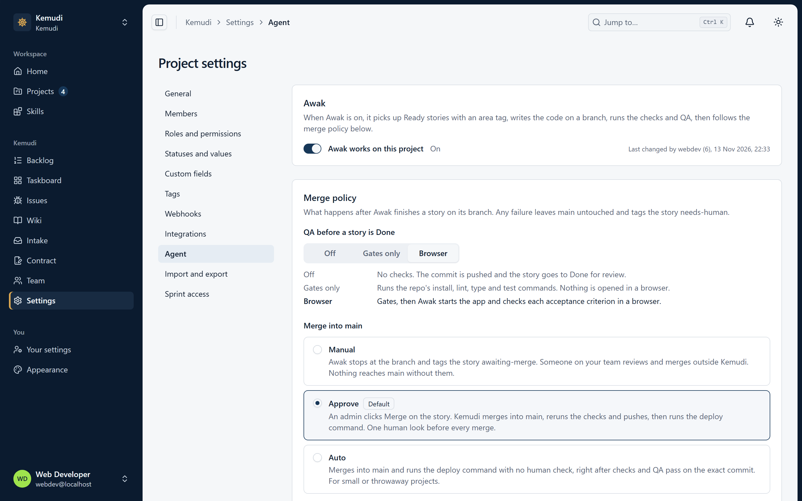
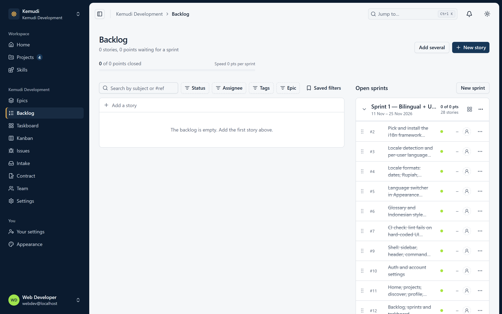

<div align="center">

# ☸ Kemudi

**The delivery control system for IT vendors working under contract.**

Kemudi turns your contract into a baseline, flags every out-of-scope request as a
billable change, and lets an AI crew ship the work, all inside your own infrastructure.

[Capabilities](#capabilities) · [Screenshots](#a-closer-look) · [Quick start](#quick-start-development) · [Roadmap](#roadmap)


<sub>CR check backtest on a real pilot contract: 19 of 20 requests labelled the way the PM decided, every Change Request caught, no in-scope request flagged.</sub>

</div>

---

Kemudi is open source and built on the [Taiga](https://taiga.io) backend, with a
new web UI and an AI agent, **Awak**, that works alongside the team.

> **Status: early.** The web UI covers everything taiga-front does
> ([coverage](docs/web-feature-coverage.md)). The contract baseline, the CR check
> backtest, intake and the Awak dev loop run end to end. See [Roadmap](#roadmap).

## Capabilities

| | |
|---|---|
| 📄 **Contract → baseline** | Upload the signed SOW or SPK (PDF or DOCX). Kemudi reads it into numbered sections and drafts a baseline of modules, features, obligations and terms, each citing its clause and carrying its contract price. A PM edits it, then approves it as a locked version. |
| 🚩 **CR check** | Every request is classified against the baseline: *in baseline*, *CR candidate* (with an effort and price estimate from your rate card), or *needs clarification*, with the reasoning shown. Kemudi AI suggests; a project admin decides. |
| 🔁 **Backtest** | Replay past requests through the CR check and compare with what the PM actually decided, before you trust it on live work. |
| 📥 **Intake** | Paste a brief, meeting notes or a client email, or drop a document. Kemudi drafts user stories with acceptance criteria, in English or Bahasa Indonesia, for you to check before they land in the backlog. |
| 🤖 **Awak, the AI developer** | Tag a Ready story `agent-ready` and Awak picks it up: it writes the code on its own branch, runs your install, lint, type and test gates, then checks every acceptance criterion in a real browser with Playwright and attaches the screenshots to the story. Failures go back to *In progress* with the reasons, up to 3 attempts. |
| 🛡️ **Merge policy you control** | Per project: *Manual* (Awak stops at the branch), *Approve* (an admin clicks Merge; Kemudi reruns the checks, pushes and deploys) or *Auto* for throwaway projects. QA can be off, gates only, or full browser QA. |
| 🧰 **Skills library and marketplace** | Give Awak reference material: write or upload skills, or install them from GitHub marketplaces pinned to an exact commit. Every skill is scanned, licence-checked and enabled per role; updates wait for approval. |
| 🔌 **Bring your own model** | Awak runs on [Hermes](https://github.com/NousResearch/hermes-agent) with any OpenAI-compatible endpoint (OpenAI, OpenRouter, DeepSeek, Groq, or a local model through Ollama), so nothing has to leave your network. |
| 🗂️ **Full agile PM** | Epics, backlog and sprints, taskboard with burndown, kanban, issues, wiki, timeline, saved filters, roles and permissions, sprint access per role, webhooks, Git integrations, and importers for Jira, Trello, GitHub and Asana. |
| 🇮🇩 **Bilingual** | The UI speaks English and Bahasa Indonesia, switchable per user, with local formats for dates, Rupiah and WIB/WITA/WIT. |

## A closer look

### Contract, intake and CR check

Kemudi measures every request against what was signed. Paste the client's message
in whatever form it arrives and Kemudi drafts the stories.


### Awak ships the story, with proof

Each story Awak finishes carries the QA screenshots for its acceptance criteria,
so a reviewer sees what was checked without running anything.


<table>
  <tr>
    <td width="50%"></td>
    <td width="50%"></td>
  </tr>
  <tr>
    <td align="center"><sub><b>Agent settings</b>: switch Awak on, choose the QA level and merge policy</sub></td>
    <td align="center"><sub><b>Skills</b>: scanned, licence-checked and assigned per role</sub></td>
  </tr>
</table>


### Everyday project management

The full Taiga feature set in a fast, modern UI.

<table>
  <tr>
    <td width="50%"></td>
    <td width="50%"></td>
  </tr>
  <tr>
    <td align="center"><sub><b>Backlog</b> with sprint planning</sub></td>
    <td align="center"><sub><b>Taskboard</b> with burndown</sub></td>
  </tr>
  <tr>
    <td width="50%"></td>
    <td width="50%"></td>
  </tr>
  <tr>
    <td align="center"><sub><b>Kanban</b> with saved filters and card density</sub></td>
    <td align="center"><sub><b>Epics</b> with progress across sprints</sub></td>
  </tr>
</table>

## Why Kemudi

Jira and Linear already own "AI on a kanban board". Kemudi is built for the
vendor delivering under a contract:

1. **It understands the contract.** The SOW becomes the baseline, and scope drift
   shows up as billable change instead of lost margin.
2. **It runs where the data must stay.** Self-hosted or on-prem, with a swappable
   AI engine and local models for banks, BUMN and government clients.
3. **It speaks the client's language.** Bahasa Indonesia and English, side by side.

## Repository layout

```
kemudi/
├── apps/
│   ├── web/              # new UI (React, shadcn/ui), see apps/web/README.md
│   └── orchestrator/     # Kemudi AI service: contract baseline, CR check, Awak loop
├── services/
│   ├── kemudi-back/      # fork of taiga-back 6.10.2 (MPL-2.0), git subtree
│   ├── kemudi-events/    # fork of taiga-events 6.10.0 (MPL-2.0), git subtree
│   └── awak/             # fork of NousResearch/hermes-agent (MIT), git submodule
├── infra/
│   ├── docker-compose.dev.yml
│   ├── gateway/          # nginx config for the dev stack
│   ├── awak/             # Awak's Hermes config and Taiga bootstrap
│   └── runner/           # runs Awak's branches: install, gates, Playwright QA
├── docs/                 # ADRs, architecture, third-party licenses
└── LICENSES/             # AGPL-3.0, MPL-2.0, MIT
```

## Quick start (development)

Requirements: Docker with Compose v2, Git.

```sh
git clone --recurse-submodules https://github.com/arifnurdiansyah92/kemudi.git
cd kemudi
cp infra/.env.example infra/.env
docker compose -f infra/docker-compose.dev.yml --env-file infra/.env up -d --build
docker compose -f infra/docker-compose.dev.yml --env-file infra/.env exec kemudi-back \
    python manage.py createsuperuser
```

Open <http://localhost:9100> for the Kemudi UI. The stock `taigaio/taiga-front`
still runs at <http://localhost:9101> against the same backend and accounts,
for comparison while it is retired.

To work on the UI with hot reload, run `pnpm dev` in `apps/web` (Node 22.12+)
and open <http://localhost:5173>. See [apps/web/README.md](apps/web/README.md).

If you cloned without `--recurse-submodules`: `git submodule update --init --depth 1`.

## Working with the forks

`kemudi-back` and `kemudi-events` are git subtrees, so their full upstream
history lives in this repo and upstream releases can be merged in:

```sh
git remote add taiga-back https://github.com/taigaio/taiga-back.git
git fetch --no-tags taiga-back tag 6.11.0
git subtree merge --prefix=services/kemudi-back 6.11.0 --squash
```

Keep changes to `kemudi-back` small and isolated so these merges stay easy.
See [docs/adr/0001-monorepo-and-forks.md](docs/adr/0001-monorepo-and-forks.md).

`awak` is a submodule pointing at
[arifnurdiansyah92/hermes-agent](https://github.com/arifnurdiansyah92/hermes-agent)
because upstream is ~1.4 GB. Make Awak changes in that fork, then bump the
submodule here.

## Roadmap

1. **Monorepo and forks**: done.
2. **`apps/web`**: new UI based on [shadcn-admin](https://github.com/satnaing/shadcn-admin).
   Covers taiga-front's features plus sprint access; the remaining taiga-v2
   patches (link items, clone, board fields, move task) come next.
3. **Kemudi AI**: `apps/orchestrator`.
   - Contract baseline and CR check: backtest POC done
     ([report](docs/poc/2026-11-pilot-backtest.md)); live CR check next.
   - Awak dev loop, iteration 1: request → stories → Awak codes on an
     `awak/us-<n>` branch → gates → Playwright QA with screenshots → Done or
     rework ([design](docs/superpowers/specs/2026-11-13-awak-dev-loop-design.md),
     [how to run](apps/orchestrator/README.md#awak-dev-loop)).

## License

Code written for Kemudi (everything outside `services/`) is licensed under
**AGPL-3.0-or-later**. Forked components keep their own licenses:

| Component | Upstream | License |
|---|---|---|
| services/kemudi-back | taigaio/taiga-back | MPL-2.0 |
| services/kemudi-events | taigaio/taiga-events | MPL-2.0 |
| services/awak | NousResearch/hermes-agent | MIT |

See [NOTICE](NOTICE) and [LICENSES/](LICENSES/).
