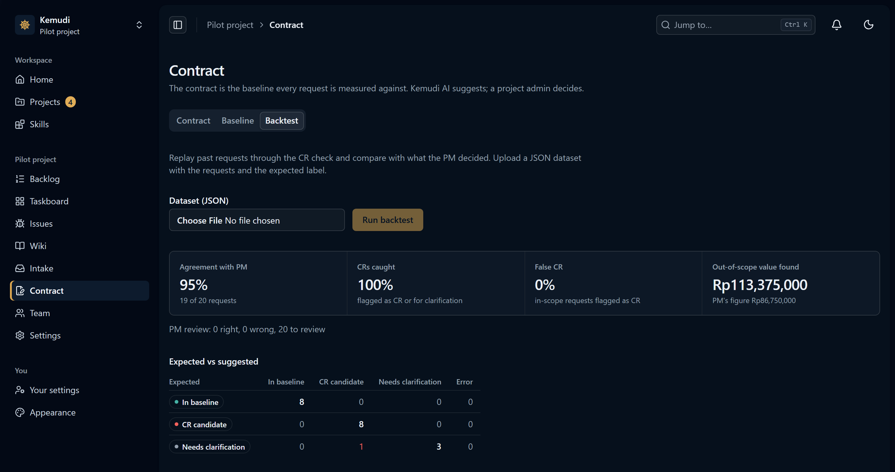
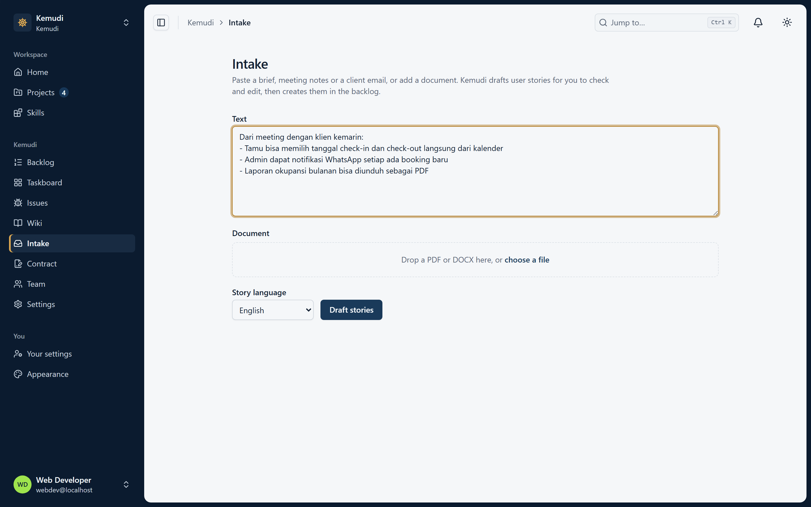
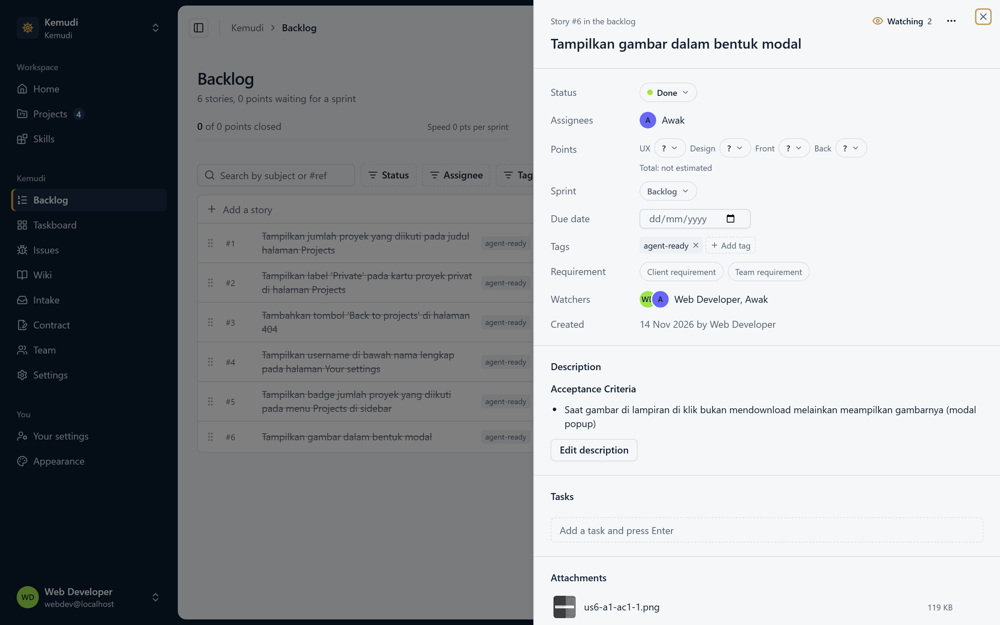
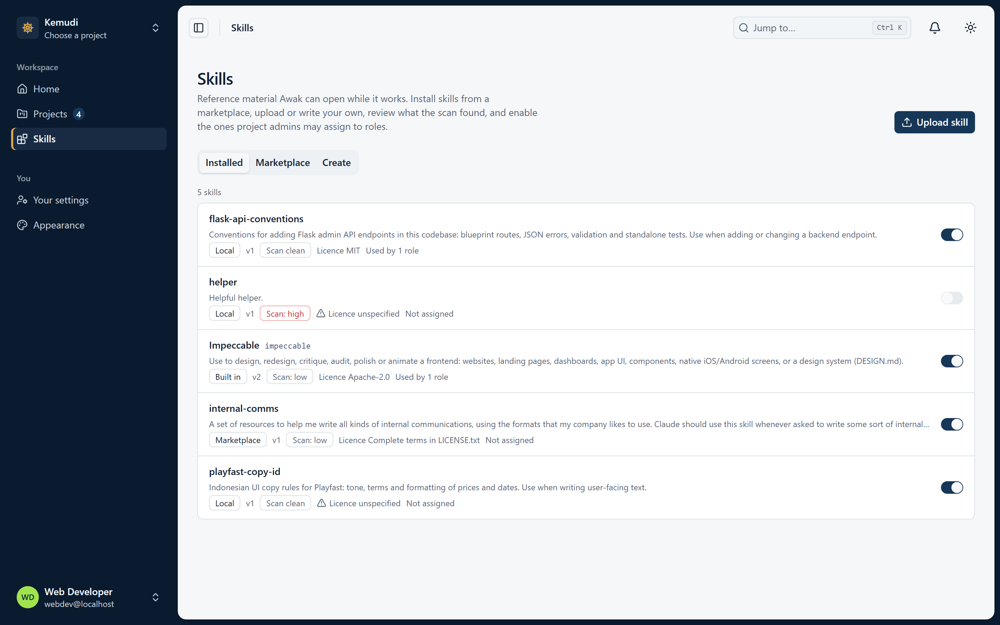
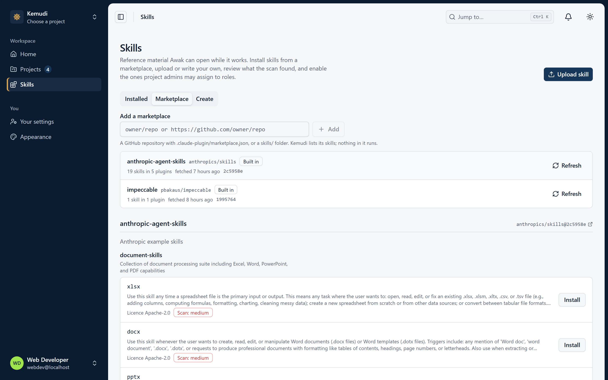
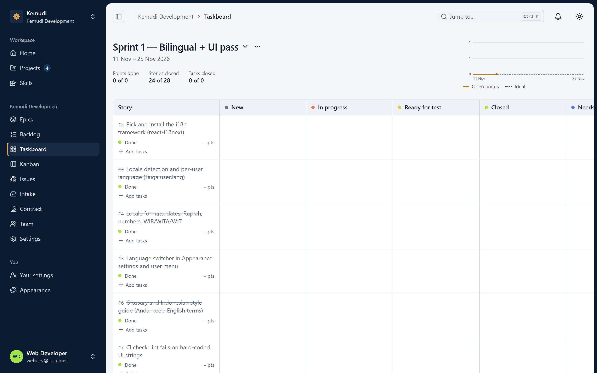
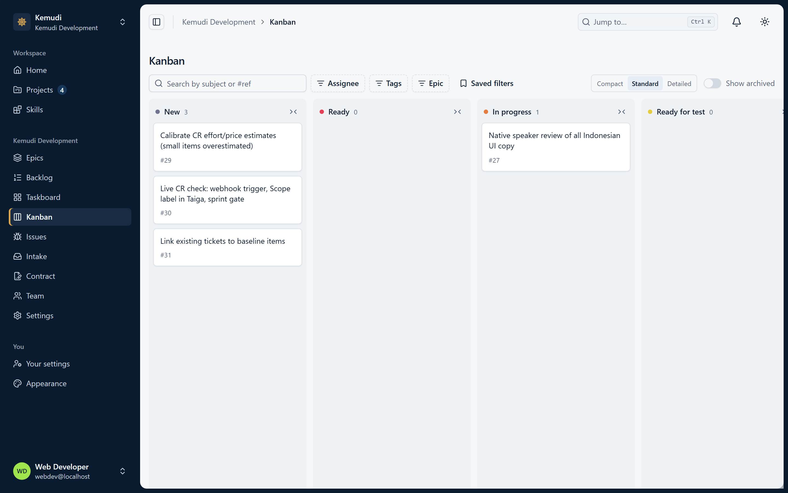
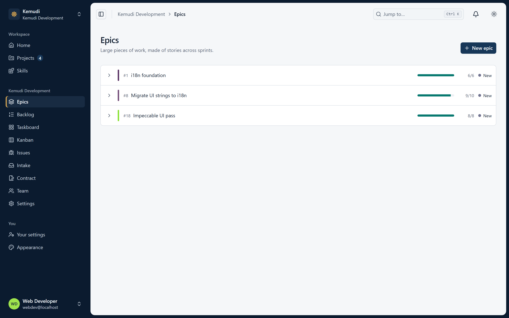

<div align="center">

# Kemudi

**Contract-driven delivery management for IT vendors and system integrators.**

Kemudi establishes the signed contract as the baseline for every project,
identifies out-of-scope requests as billable change, and deploys an AI
engineering agent to deliver the work, entirely within your own infrastructure.

[Capabilities](#capabilities) · [Product tour](#product-tour) · [Roadmap](#roadmap) · [Getting started](#getting-started)



<sub>Change request backtest on a pilot contract: the classification matched the project manager's decision on 19 of 20 requests, identified every change request, and raised no false positives.</sub>

</div>

---

## Overview

IT vendors delivering under contract face a recurring problem: requests arrive
informally, scope expands without being priced, and margin erodes before anyone
notices. General-purpose project management tools are designed for product
teams and have no notion of a contract.

Kemudi is built for the vendor's delivery model. It is open source, runs on the
proven [Taiga](https://taiga.io) backend, and pairs a modern web interface with
**Awak**, an AI agent that implements, tests and documents work alongside the
delivery team.

> **Project status.** Kemudi is in active early development. The web interface
> provides full parity with Taiga ([coverage report](docs/web-feature-coverage.md)).
> Contract baselining, change request backtesting, intake and the Awak delivery
> loop are operational end to end. See the [Roadmap](#roadmap) for what follows.

## Capabilities

### Contract intelligence

| Capability | Description |
|---|---|
| **Contract baseline** | Upload a signed SOW or SPK in PDF or DOCX format. Kemudi structures the document into numbered sections and drafts a baseline of modules, features, obligations and terms, each traceable to its source clause and contract value. The baseline is reviewed by the project manager and locked as a versioned record on approval. |
| **Change request detection** | Each incoming request is assessed against the approved baseline and classified as *in baseline*, *change request candidate* or *requires clarification*. Change request candidates include an effort and price estimate based on the vendor's rate card. Every assessment states its reasoning, and the final decision always rests with a project administrator. |
| **Backtesting** | Historical requests can be replayed against the baseline and compared with the decisions the project manager actually made, so the classification can be validated before it is relied upon in live delivery. |
| **Intake** | Briefs, meeting notes, client emails and documents are converted into draft user stories with acceptance criteria, in English or Bahasa Indonesia, for review before they enter the backlog. |

### AI-assisted delivery

| Capability | Description |
|---|---|
| **Awak delivery agent** | Stories marked as ready for the agent are implemented by Awak on a dedicated branch. Each change passes the project's install, lint, type-check and test gates, followed by browser-based verification of every acceptance criterion with Playwright. Screenshots are attached to the story as evidence. Failed attempts are returned with a full explanation and retried up to three times. |
| **Governed merging** | Each project defines its own merge policy: *Manual*, where changes stop at the branch for team review; *Approve*, where an administrator authorises the merge and Kemudi re-runs all checks before pushing and deploying; or *Auto*, intended for low-risk projects. Quality assurance can be set to off, gates only, or full browser verification. |
| **Project workspace and runbook** | Each project maintains its repositories, services, health checks, commands and an encrypted secrets vault that is never exposed to the model. The Setup Assistant proposes a runbook automatically and proves it by building and starting the application before it is saved. |
| **Skills library and marketplace** | Awak can be equipped with organisation-specific reference material. Skills can be authored in Kemudi, uploaded, or installed from GitHub-based marketplaces pinned to an exact commit. Every skill is security-scanned and licence-checked, enabled per role, and subject to approval before updates take effect. |
| **Model independence** | Awak runs on [Hermes](https://github.com/NousResearch/hermes-agent) and connects to any OpenAI-compatible endpoint, including OpenAI, OpenRouter, DeepSeek, Groq, or a locally hosted model through Ollama. Organisations with strict data residency requirements can keep all processing within their own network. |

### Project management

| Capability | Description |
|---|---|
| **Agile delivery** | Epics, backlog and sprint planning, taskboards with burndown charts, kanban boards, issue tracking, wiki and timeline. |
| **Governance and access** | Roles and permissions, sprint-level access control per role, watchers, webhooks, and integrations with GitHub, GitLab, Bitbucket and Gogs. |
| **Migration** | Importers for Jira, Trello, GitHub and Asana. |
| **Bilingual by design** | A complete English and Bahasa Indonesia interface, selectable per user, with localised formatting for dates, Rupiah amounts and the WIB, WITA and WIT time zones. |

## Product tour

### From client request to backlog

Client requests rarely arrive in a structured form. Intake accepts them as they
are and produces reviewable user stories.



### Verified delivery by Awak

Every story completed by Awak carries the evidence of its verification, allowing
reviewers to confirm the outcome without reproducing it themselves.



<table>
  <tr>
    <td width="50%"></td>
    <td width="50%"></td>
  </tr>
  <tr>
    <td align="center"><sub><b>Agent settings</b>: quality assurance level and merge policy per project</sub></td>
    <td align="center"><sub><b>Skills library</b>: scanned, licence-checked and assigned per role</sub></td>
  </tr>
</table>



### Day-to-day project management

The complete Taiga feature set, delivered through a faster and more consistent
interface.

<table>
  <tr>
    <td width="50%"></td>
    <td width="50%"></td>
  </tr>
  <tr>
    <td align="center"><sub><b>Backlog</b> and sprint planning</sub></td>
    <td align="center"><sub><b>Taskboard</b> with burndown</sub></td>
  </tr>
  <tr>
    <td width="50%"></td>
    <td width="50%"></td>
  </tr>
  <tr>
    <td align="center"><sub><b>Kanban</b> with saved filters and adjustable card density</sub></td>
    <td align="center"><sub><b>Epics</b> with progress across sprints</sub></td>
  </tr>
</table>

## Why Kemudi

AI-assisted task boards are now commonplace. Kemudi differentiates on the needs
specific to contract delivery:

1. **Contract awareness.** The statement of work becomes the project baseline,
   so scope changes are captured as billable change requests rather than
   absorbed as cost.
2. **Data sovereignty.** Kemudi is deployed self-hosted or on-premises, with an
   interchangeable AI engine and support for local models, meeting the
   requirements of banking, state-owned enterprise and government clients.
3. **Local language support.** Bahasa Indonesia and English are supported
   throughout the product.

## Roadmap

**Delivered**

- **Platform foundation.** Monorepo with maintained forks of taiga-back and
  taiga-events, and a new web interface at full Taiga parity, including
  sprint-level access control.
- **Bilingual interface.** Internationalisation framework, English and Bahasa
  Indonesia translations, and localised formats.
- **Contract baseline and change request backtest.** Contract ingestion,
  versioned baselines and a backtest validated on a pilot contract
  ([report](docs/poc/2026-11-pilot-backtest.md)).
- **Intake.** Conversion of briefs, notes and documents into draft user stories.
- **Awak delivery loop.** Story-to-branch implementation with quality gates and
  browser verification ([design](docs/superpowers/specs/2026-11-13-awak-dev-loop-design.md),
  [operating guide](apps/orchestrator/README.md#awak-dev-loop)).
- **Awak project configuration.** Bring-your-own model connection, repositories,
  roles and access, merge policy, project workspace and runbook, encrypted
  secrets vault, and the Setup Assistant.
- **Skills.** Skills runtime, library and marketplace with scanning, licence
  checks and update approval.

**In progress**

- Native-speaker review of all Bahasa Indonesia interface copy.

**Next**

- **Live change request detection.** Automatic assessment of new tickets,
  scope labels on the board, and a sprint gate for unresolved change requests.
- **Estimate calibration.** Improved accuracy of change request effort and
  price estimates.
- **Baseline traceability.** Linking existing tickets to baseline items.
- **Status reporting.** Automatically generated weekly status reports.
- **Board enhancements.** Linked items, cloning, board fields, filter search
  and moving tasks between stories.

**Later**

- Per-story preview environments with automatic clean-up.
- Awak execution on client infrastructure over SSH.
- Stories spanning multiple repositories.
- A read-only client portal, a multi-client portfolio view with schedule and
  margin health, WhatsApp intake, and single sign-on.

## Getting started

Requirements: Docker with Compose v2, Git.

```sh
git clone --recurse-submodules https://github.com/arifnurdiansyah92/kemudi.git
cd kemudi
cp infra/.env.example infra/.env
docker compose -f infra/docker-compose.dev.yml --env-file infra/.env up -d --build
docker compose -f infra/docker-compose.dev.yml --env-file infra/.env exec kemudi-back \
    python manage.py createsuperuser
```

The Kemudi interface is available at <http://localhost:9100>. The original
`taigaio/taiga-front` remains available at <http://localhost:9101>, connected
to the same backend and accounts, for reference until it is retired.

For interface development with hot reload, run `pnpm dev` in `apps/web`
(Node 22.12 or later) and open <http://localhost:5173>. See [apps/web/README.md](apps/web/README.md).

If the repository was cloned without `--recurse-submodules`, run
`git submodule update --init --depth 1`.

### Repository layout

```
kemudi/
├── apps/
│   ├── web/              # new UI (React, shadcn/ui), see apps/web/README.md
│   └── orchestrator/     # Kemudi AI service: contract baseline, CR check, Awak loop
├── services/
│   ├── kemudi-back/      # fork of taiga-back 6.10.2 (MPL-2.0), git subtree
│   ├── kemudi-events/    # fork of taiga-events 6.10.0 (MPL-2.0), git subtree
│   └── awak/             # fork of NousResearch/hermes-agent (MIT), git submodule
├── infra/
│   ├── docker-compose.dev.yml
│   ├── gateway/          # nginx config for the dev stack
│   ├── awak/             # Awak's Hermes config and Taiga bootstrap
│   └── runner/           # runs Awak's branches: install, gates, Playwright QA
├── docs/                 # ADRs, architecture, third-party licenses
└── LICENSES/             # AGPL-3.0, MPL-2.0, MIT
```

### Working with the forks

`kemudi-back` and `kemudi-events` are maintained as git subtrees. Their full
upstream history is retained in this repository, so upstream releases can be
merged directly:

```sh
git remote add taiga-back https://github.com/taigaio/taiga-back.git
git fetch --no-tags taiga-back tag 6.11.0
git subtree merge --prefix=services/kemudi-back 6.11.0 --squash
```

Changes to `kemudi-back` should remain small and isolated to keep these merges
straightforward.
See [docs/adr/0001-monorepo-and-forks.md](docs/adr/0001-monorepo-and-forks.md).

`awak` is a submodule referencing
[arifnurdiansyah92/hermes-agent](https://github.com/arifnurdiansyah92/hermes-agent),
as the upstream repository is approximately 1.4 GB. Changes to Awak are made in
that fork and then reflected here by updating the submodule.

## License

Code written for Kemudi (everything outside `services/`) is licensed under
**AGPL-3.0-or-later**. Forked components keep their own licenses:

| Component | Upstream | License |
|---|---|---|
| services/kemudi-back | taigaio/taiga-back | MPL-2.0 |
| services/kemudi-events | taigaio/taiga-events | MPL-2.0 |
| services/awak | NousResearch/hermes-agent | MIT |

See [NOTICE](NOTICE) and [LICENSES/](LICENSES/).
